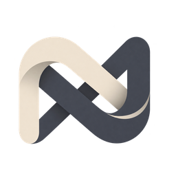
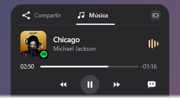
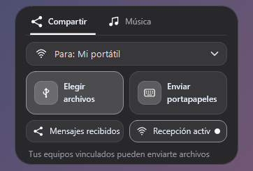
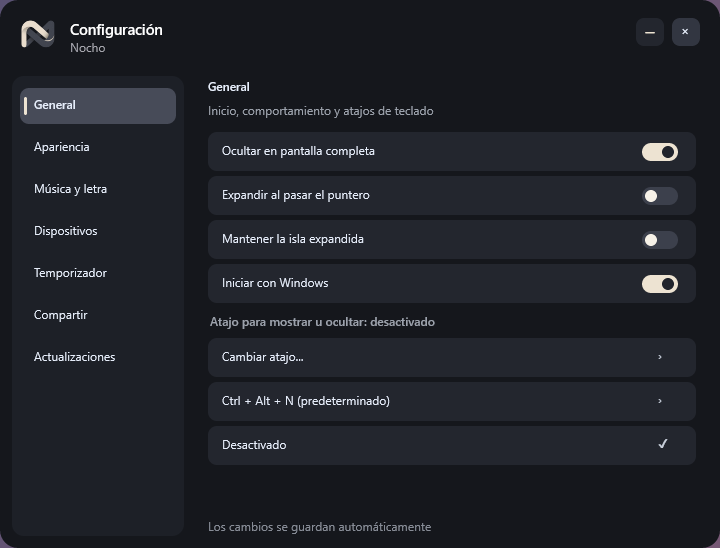

  

<h1 align="center">Nocho</h1>

  Una isla dinámica para Windows: tu música, tus avisos y tus archivos en una píldora en el borde superior de la pantalla.

  <a href="https://github.com/UtilityForCoders/Nocho/releases/latest"><b>Descargar para Windows</b></a>
  ·
  <a href="#qué-puedes-hacer">Qué puedes hacer</a>
  ·
  <a href="#preguntas-frecuentes">Preguntas frecuentes</a>

  

Nocho vive arriba, al centro de la pantalla, como una línea delgada que no estorba. Haz clic en ella y se abre una isla con la canción que suena en cualquier app (Spotify, YouTube en el navegador, Apple Music…), sus controles y su letra. Saca el puntero y vuelve a esconderse sola.

Es liviana: en reposo no usa CPU y solo se anima mientras la estás usando.

## Instalar

1. Descarga **`nocho-setup-x.y.z.exe`** desde la [última versión](https://github.com/UtilityForCoders/Nocho/releases/latest).
2. Ábrelo. No pide permisos de administrador.
3. Listo: la línea aparece arriba al centro. Si marcaste **Iniciar con Windows**, estará ahí cada vez que prendas el PC.

¿Prefieres no instalar nada? Descarga **`nocho.exe`** y ábrelo directamente (versión portable; no se actualiza sola).

Requiere Windows 10 (versión 1809 o posterior) u 11, de 64 bits.

> Los archivos todavía no están firmados, así que Windows SmartScreen puede mostrar un aviso la primera vez: elige **Más información → Ejecutar de todas formas**.

## Qué puedes hacer

### Controlar tu música desde cualquier lugar

- **Un clic en la línea** abre el reproductor: carátula, título, artista, tiempo y los botones anterior, play/pausa y siguiente.
- **Aleatorio y repetir** a los lados de los controles, en las apps que los ofrecen (como Spotify). Repetir alterna entre apagado, toda la lista y solo la canción.
- **Salta a cualquier parte** de la canción con un clic en la barra de progreso.
- **Sube o baja el volumen** girando la rueda del mouse sobre la isla: cambia solo el de la app que suena, como el Mezclador de volumen. Con **Ctrl** apretado cambia el volumen general.
- **Varias apps con música**: unos puntos bajo la carátula lo indican; un clic en la carátula pasa a la siguiente. En la esquina de la carátula ves el ícono de la app que suena.
- **Barras de audio** que siguen el sonido real de la canción y toman el color de la carátula.
- **Elige por dónde suena cada app**: con clic derecho sobre la isla, por ejemplo Spotify en los audífonos y el resto en los parlantes.

### Seguir la letra

Nocho busca la letra sincronizada de la canción y la muestra de dos formas, que puedes activar por separado en **Configuración → Música y letra**:

- **Con la isla abierta**: la letra corre como un carrusel debajo de los controles, resaltando lo que se va cantando.
- **Con la línea de reposo**: el verso que se canta aparece flotando bajo la línea, en una píldora negra que no tapa nada (los clics la atraviesan).

Funciona con las apps que informan el avance de la canción, como Spotify. La letra viene de [LRCLIB](https://lrclib.net).

### Compartir con tus otros equipos

  

Envía archivos, fotos, texto o lo que tengas copiado a otro PC con Nocho en la misma red, sin cuentas ni nube:

1. Vincula los equipos una sola vez: abre **Compartir** en ambos PCs, elige **Vincular equipo** y confirma que el código coincida en las dos pantallas.
2. Para enviar, **arrastra archivos sobre la isla**, usa **Elegir archivos** o **Enviar portapapeles**.
3. El texto y las imágenes llegan con una vista previa para copiarlos; los demás archivos piden permiso antes de guardarse en Descargas.

Las conexiones van cifradas y solo tus equipos vinculados pueden enviarte cosas. Si no quieres recibir nada por un rato, activa **No molestar**.

### Avisos que llegan a la isla

- **Batería baja** de tu mouse, teclado, audífonos o mando (Bluetooth, mandos de juego y algunos receptores USB). En **Configuración → Dispositivos** ves el nivel de cada uno.
- **Dispositivo conectado**: el nombre de los audífonos o el mouse que acabas de conectar.
- **Cambio de salida de audio**: a qué parlantes o audífonos pasó el sonido.
- **Temporizador**: duraciones rápidas de 5 a 60 minutos o la que elijas (hasta 3 horas); al terminar suena y la isla avisa. También hay **cronómetro** y **Pomodoro** (25 minutos de foco y 5 de descanso, con un descanso largo cada cuatro). La cuenta se ve en una píldora bajo la línea de reposo.
- **Tomar agua**: fija tu meta diaria y cada cuánto quieres que te lo recuerde. Un clic en el aviso anota un vaso; el conteo empieza de cero cada día.
- **Actualización lista**: un clic y se instala sola, sin ventanas.

### Se adapta a cómo trabajas

- **Se esconde en pantalla completa** (juegos, videos, presentaciones) y vuelve cuando sales.
- **Atajo de teclado**: **Ctrl + Alt + N** la muestra u oculta. Puedes cambiarlo o desactivarlo.
- **Arrástrala** hacia los lados si la quieres en otro lugar del borde; doble clic la vuelve al centro.
- **Elige la pantalla** donde va, si tienes más de una.
- **Personaliza el color** de la isla y el **desenfoque del fondo**, o déjala en negro opaco.
- **Ábrela al pasar el puntero** en lugar de con un clic, si lo prefieres.

## Configuración

  

Haz clic derecho en el ícono de Nocho en la bandeja del sistema y elige **Configuración**. Las opciones están ordenadas en **General**, **Apariencia**, **Música y letra**, **Dispositivos**, **Temporizador**, **Hidratación**, **Compartir** y **Actualizaciones**. Los cambios se guardan solos.

## Preguntas frecuentes

**¿Consume mucha batería o CPU?**
No. En reposo no usa CPU: solo se anima mientras la estás usando, y las tareas de fondo (baterías, equipos cercanos) son livianas.

**¿Funciona con YouTube, Apple Music, Tidal…?**
Con cualquier app que muestre sus controles en el panel de multimedia de Windows (el que aparece al subir el volumen). La letra sincronizada y la barra de progreso dependen de que la app informe el avance de la canción.

**No veo la letra de una canción.**
No todas las canciones tienen letra sincronizada en LRCLIB. Mientras la busca, o si no la encuentra, la isla muestra el reproductor sin espacio vacío.

**¿Cómo se actualiza?**
Sola. Cada cierto tiempo revisa si hay una versión nueva, la descarga, comprueba que sea la publicada y te avisa; un clic y se instala. También puedes buscarla a mano en **Configuración → Actualizaciones**.

**¿Qué datos envía?**
Solo lo necesario para la letra (título, artista, álbum y duración de la canción, a LRCLIB) y la consulta de actualizaciones a GitHub. No tiene cuentas, anuncios ni estadísticas de uso. Los detalles están en [PRIVACY.md](PRIVACY.md).

**¿Cómo la desinstalo?**
Desde **Configuración de Windows → Aplicaciones instaladas → Nocho**. También quita el inicio con Windows.

## Seguridad y privacidad

- [Política de privacidad](PRIVACY.md)
- [Cómo reportar un problema de seguridad](SECURITY.md)

## Para desarrolladores

Nocho está escrito en Rust y usa directamente las APIs de Windows. Cómo compilarla, probarla, armar el instalador y cómo está hecha por dentro: [docs/desarrollo.md](docs/desarrollo.md).

## Licencia

[MIT](LICENSE).
